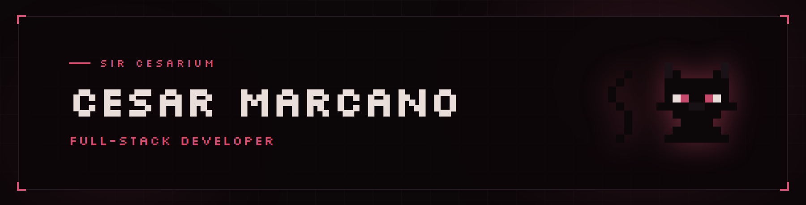
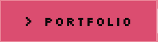
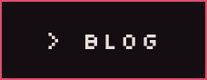
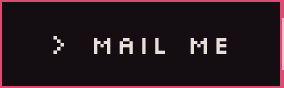
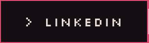
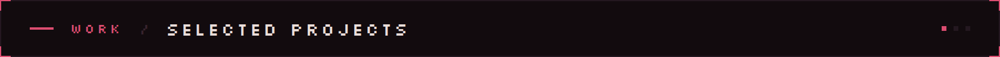
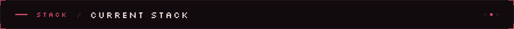
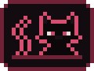

<picture>
  <source media="(max-width: 700px)" srcset="./assets/banner-mobile.png" />
  
</picture>

 
 

 

<picture>
  <source media="(max-width: 700px)" srcset="./assets/sec-projects-mobile.png" />
  
</picture>

 

**[modcrawl](https://github.com/SirCesarium/modcrawl)** · `Rust` `TypeScript` `WASM` `SvelteKit` 
Inspect Minecraft mods without opening a single JAR. Reads metadata, traces crashes to their origin mod, classifies client/server sides, flags duplicate classes and mixin conflicts. Available as a CLI, a Rust library, and an npm package.

**[re-color](https://github.com/SirCesarium/re-color)** · [recolor.pages.dev](https://recolor.pages.dev) · `SvelteKit` `TypeScript` `PWA` `WASM` 
Extract a color palette from any image and use it to repaint a pixel-art sprite — entirely in the browser. No uploads, no server. Runs in a Web Worker so the canvas never blocks.

**[zipcrawl](https://github.com/SirCesarium/zipcrawl)** · `Rust` `CLI` 
Ergonomic CLI and Rust library for exploring ZIP archives safely. Zip-bomb and path-traversal guards on every read.

**[stack-nav](https://github.com/SirCesarium/stack-nav)** · [npm](https://www.npmjs.com/package/stack-nav) · `React` `TypeScript` 
Zero-dependency, 1.2 kB state-based navigation for React apps that don't rely on browser URLs. Built for Tauri and Electron shells.

**[minecraft-registry-api](https://github.com/SirCesarium/minecraft-registry-api)** · [crates.io](https://crates.io/crates/minecraft_registry_api) · `Rust` `API` 
Typed Rust clients for Modrinth, Mojang, Paper, Purpur, Fabric, Forge and NeoForge. Every response maps 1:1 to the platform's own JSON.

**[hellcat-theme](https://github.com/SirCesarium/hellcat-theme)** · [Marketplace](https://marketplace.visualstudio.com/items?itemName=SirCesarium.hellcat-theme) · `VS Code` `GTK` 
Dark gruvbox-inspired color theme in three variants for VS Code, GTK, and terminals.

 

<picture>
  <source media="(max-width: 700px)" srcset="./assets/sec-stack-mobile.png" />
  
</picture>

<table align="center">
<tr>
<td width="100" valign="middle"><strong>Primary</strong></td>
<td valign="middle"></td>
</tr>
<tr>
<td valign="middle"><strong>Regular</strong></td>
<td valign="middle"></td>
</tr>
<tr>
<td valign="middle"><strong>Occasional</strong></td>
<td valign="middle"></td>
</tr>
</table>

 

<picture>
  <source media="(max-width: 700px)" srcset="./assets/sec-contact-mobile.png" />
  
</picture>

<h2>Let's build something.</h2>

I'm open to remote roles. I care more about the problem than the stack.

 

 

